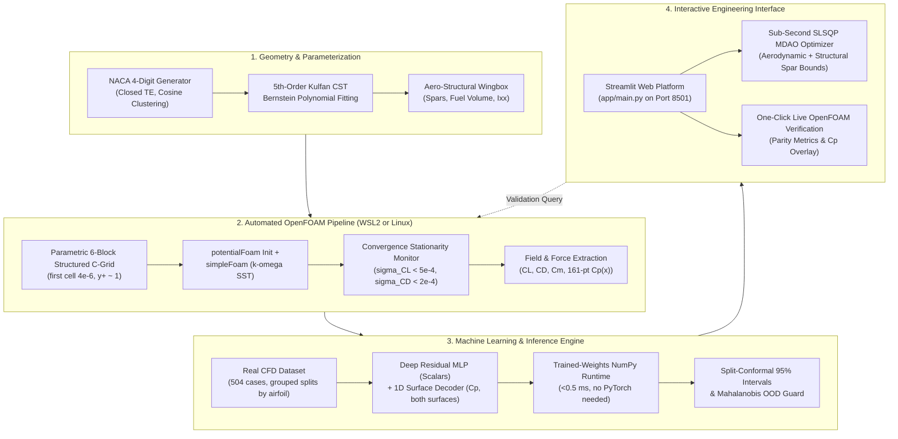

# NeuroFoil: ML-Accelerated Aerodynamic Design & CFD Verification Platform

An automated engineering platform integrating 2D Reynolds-Averaged Navier–Stokes (RANS)
OpenFOAM simulations, neural surrogate modeling for forces and surface pressure
distributions, coupled aero-structural wingbox mechanics, and calibrated uncertainty
quantification (UQ).

The platform bridges high-fidelity computational fluid dynamics with sub-millisecond
design space exploration, enabling constrained multidisciplinary design optimization
(MDAO) while maintaining an automated verification loop against OpenFOAM ground truth.

> **Status:** the training dataset is being regenerated by a real OpenFOAM campaign
> (504 cases: 21 airfoils × 4 Reynolds numbers × 6 angles of attack). The surrogate
> is trained from that dataset via `notebooks/neurofoil_surrogate_training_v2.ipynb`
> (Kaggle/local GPU) and deployed through a pure-NumPy runtime
> (`src/models/inference.py`, backend reported per prediction). Until the trained
> weights are present, the engine falls back to an analytic thin-airfoil model and
> labels it via `predict()["model_backend"]`.

---

## 1. System Architecture



---

## 2. Mathematical & Engineering Foundations

### 2.1 Geometry & Class-Shape Transformation (CST)
Airfoil profiles are parameterized using the NACA 4-digit formulation with a modified trailing-edge closure coefficient ($a_4 = -0.1036$) to eliminate finite trailing-edge thickness singularities during structured mesh generation:

$$y_t(x) = 5t \left( 0.2969\sqrt{x} - 0.1260x - 0.3516x^2 + 0.2843x^3 - 0.1036x^4 \right)$$

Surfaces are fitted to a 5th-order Kulfan Class-Shape Transformation (CST) representation using Bernstein polynomials:

$$y(x) = C(x) \cdot S(x) + x \cdot \Delta z_{TE}, \quad C(x) = x^{0.5} (1 - x)^{1.0}, \quad S(x) = \sum_{i=0}^N A_i \binom{N}{i} x^i (1 - x)^{N - i}$$

This maps each airfoil into an invariant 12-dimensional parameter vector ($\mathbf{A}_{upper}, \mathbf{A}_{lower} \in \mathbb{R}^6$) for dimension reduction and geometric interpolation.

### 2.2 Fluid Dynamics & Turbulence Modeling
* **Governing Equations**: Steady incompressible Navier–Stokes equations (`simpleFoam`, OpenFOAM v2606):
  $$\nabla \cdot \mathbf{U} = 0, \qquad \nabla \cdot (\mathbf{U} \otimes \mathbf{U}) = -\frac{1}{\rho}\nabla p + \nabla \cdot \left[ (\nu + \nu_t) (\nabla \mathbf{U} + (\nabla \mathbf{U})^T) \right]$$
* **Turbulence Closure**: Two-equation $k$-$\omega$ Shear Stress Transport (SST) model (Menter).
* **Initial Field**: `potentialFoam` (irrotational start) precedes every RANS run — this
  removes the large startup transient observed with uniform initialization.
* **Numerical Stability**: Under-relaxation factors p = 0.1, U = 0.3, k/ω = 0.5. Hotter
  factors (p = 0.3 / U = 0.7) produce a sustained force limit cycle on these C-grids.
* **Near-Wall Discretization**: First-cell height 4×10⁻⁶ chord (y⁺ ≈ 1 at Re = 6×10⁶),
  geometric wall-normal grading solved from the requested first-cell height.
* **Convergence Criterion**: Force-coefficient stationarity over a sliding window (last 50–100 iterations):
  $$\sigma_{C_L} < 5.0 \times 10^{-4}, \quad \sigma_{C_D} < 2.0 \times 10^{-4}, \quad \sigma_{C_m} < 5.0 \times 10^{-4}$$
  with solver residual targets p < 10⁻⁵, U, k, ω < 10⁻⁶ and a 3000-iteration cap. Every
  dataset row records its true status (`converged` / `unconverged`).

### 2.3 Aero-Structural Wingbox Mechanics
To prevent aerodynamically optimal airfoils from converging to structurally unfeasible sections, the platform computes internal cross-sectional mechanics:
* **Spar Web Depths**: Front spar at $x/c = 0.20$, rear spar at $x/c = 0.65$:
  $$h_{\text{front}} = y_u(0.20) - y_l(0.20), \quad h_{\text{rear}} = y_u(0.65) - y_l(0.65)$$
* **Fuel Bay Volume**: $A_{\text{fuel}} = \int_{0.20}^{0.65} \left(y_u(x) - y_l(x)\right) dx$
* **Bending Stiffness ($I_{xx}$)**: about the centroidal neutral axis $\bar{y}$
  (see `src/geometry/structures.py`).

### 2.4 Calibrated Uncertainty Quantification & OOD Detection
* **Split-Conformal 95% Intervals**: calibration on held-out airfoils (never seen in
  training); the 95% quantile of absolute residuals gives $C_L$, $C_D$, $C_m$ intervals
  and per-chord-point $C_p(x)$ bands. Empirical coverage on untouched test airfoils is
  reported by the training notebook.
* **Mahalanobis Distance ($D_M$)**: evaluated against the empirical covariance of the
  training manifold over (m, p, t, α, Re):
  $$D_M(\mathbf{x}) = \sqrt{(\mathbf{x} - \boldsymbol{\mu})^T \boldsymbol{\Sigma}^{-1} (\mathbf{x} - \boldsymbol{\mu})}$$
* **Certification Classification**: $D_M \le 2.5$ → Certified (in-domain);
  $2.5 < D_M \le 3.8$ or stall-proximity trigger → Moderate Uncertainty;
  $D_M > 3.8$ or envelope violation → Out-of-Distribution (flagged as uncertified).

---

## 3. Solver Verification (measured on this codebase)

NACA 0012, incompressible k-ω SST, medium C-grid (18,048 cells, y⁺ ≈ 1),
potentialFoam-initialized, relaxation p 0.1 / U 0.3 / k,ω 0.5, 3000 iterations:

| Case | CL | CD | Cm (c/4) | Status |
| :--- | :--- | :--- | :--- | :--- |
| α = 0.0°, Re = 6.0×10⁶ | −0.0042 | 0.00879 | +0.0008 | converged (CD/Cm); CL within 9.5×10⁻⁴ |
| α = 4.0°, Re = 6.0×10⁶ | +0.4388 | 0.00951 | +0.0024 | converged (σ_CL = 2.2×10⁻⁴) |

The lift slope implied by the α = 4° result (6.29 rad⁻¹) matches thin-airfoil theory
(2π) and the measured NACA 0012 experimental lift slope; the fully-turbulent drag
level (CD ≈ 0.0095) sits above the transitional experimental value (≈0.0081) as
expected for fully-turbulent RANS without a transition model.

Grid convergence (α = 4.0°, Re = 6.0×10⁶):

| Mesh | Cells | CL | CD |
| :--- | :--- | :--- | :--- |
| coarse | 8,640 | 0.43133 | 0.010730 |
| medium (production) | 18,048 | 0.43875 | 0.009509 |
| fine | 36,000 | 0.45908 | 0.008309 |

CD decreases monotonically toward the experimental value with refinement; the
medium-to-fine spacing quantifies the discretization error band of the production mesh.

---

## 4. Engineering Scope & Known Limitations

1. **2D Flow Assumption** — sectional coefficients only; no induced drag, downwash, or tip effects. Finite-wing analysis requires lifting-line/panel post-processing.
2. **Incompressible Flow Assumption** — `simpleFoam`; valid for M ≤ 0.3; no transonic effects or wave drag.
3. **Linear Eddy-Viscosity Closure** — k-ω SST (Boussinesq); delays separation onset under severe adverse gradients; no laminar–turbulent transition model (hence fully-turbulent drag levels).
4. **Calibrated Manifold Bounds** (enforced by the OOD guardrail):
   Camber 0 ≤ m ≤ 0.06 · Camber location 0 ≤ p ≤ 0.60 · Thickness 0.06 ≤ t ≤ 0.18 ·
   α ∈ [−6°, 14°] · Re ∈ [1×10⁶, 6×10⁶].
5. **Dataset Regeneration** — the shipped dataset must come from the real-OpenFOAM
   campaign (`scripts/run_dataset_campaign.py`); see `RUN_CFD_PACKAGE_README.md`.

---

## 5. Project Directory Structure

```
NeuroFoil-Core/
├── app/
│   └── main.py                       # Streamlit engineering dashboard
├── configs/
│   └── default_cfd.yaml              # Meshing, solver, relaxation, convergence settings
├── data/
│   ├── processed/                    # airfoil_cfd_dataset.csv + cp_surface_distributions.npz
│   └── raw_cases/                    # Per-case solver logs & postProcessing (gitignored)
├── models/                           # Trained weights (npz + meta + .pt) and scalers
├── notebooks/
│   └── neurofoil_surrogate_training_v2.ipynb  # Kaggle/local GPU training (grouped splits + conformal UQ)
├── paper/                            # arXiv-ready LaTeX manuscript
├── scripts/
│   ├── build_kaggle_notebook_v2.py   # Regenerates the training notebook
│   ├── run_cfd_batch.py              # Ad-hoc batch CFD runner
│   ├── run_dataset_campaign.py       # Resume-safe parallel dataset campaign (504 cases)
│   ├── run_single_case.py            # Single-case verification runner
│   └── check_env.py                  # Environment inspector
├── src/
│   ├── cfd/                          # case_builder, convergence, extractor, mesh_generator
│   ├── config.py                     # Config loader + WSL/Linux solver bridge
│   ├── dataset/                      # pipeline (single-case CFD), sampler (LHS)
│   ├── geometry/                     # naca (NACA4+CST), structures (wingbox), validator
│   └── models/                       # inference (NumPy NN runtime), uncertainty (conformal UQ)
├── tests/                            # 24 unit + integration tests
├── RUN_CFD_PACKAGE_README.md         # How to run the campaign on another machine
└── requirements.txt / pyproject.toml
```

---

## 6. Installation & Quick Start

### 6.1 Prerequisites
* **OS**: Windows 10/11 with WSL2 (Ubuntu 24.04 + OpenFOAM v2606), or native Linux.
* **Python**: 3.10, 3.11, or 3.12.
* *The inference dashboard runs without OpenFOAM or PyTorch* — OpenFOAM is only
  needed for live verification and dataset generation.

### 6.2 Setup
```bash
git clone https://github.com/BLACKNIGHT-cloud12/NeuroFoil-Core.git
cd NeuroFoil-Core
pip install -e .
```

### 6.3 Launch the Interactive Dashboard
```bash
streamlit run app/main.py
```
Open **http://localhost:8501** — real-time airfoil morphing with force readouts,
Cp(x) with conformal uncertainty bands, wingbox sizing, SLSQP inverse design,
one-click OpenFOAM verification, and full polar sweeps.

---

## 7. Running Tests

```bash
python -m pytest tests/ -v
```

All 24 unit tests pass (geometry, meshing, case building, structures, UQ,
inference backend). The WSL mesh-integration test auto-skips when WSL/OpenFOAM
is unavailable.

---

## 8. License & Citation

Distributed under the Apache License 2.0 — see [`LICENSE`](LICENSE).
Citation metadata lives in [`CITATION.cff`](CITATION.cff); the manuscript source
is under [`paper/`](paper/).
