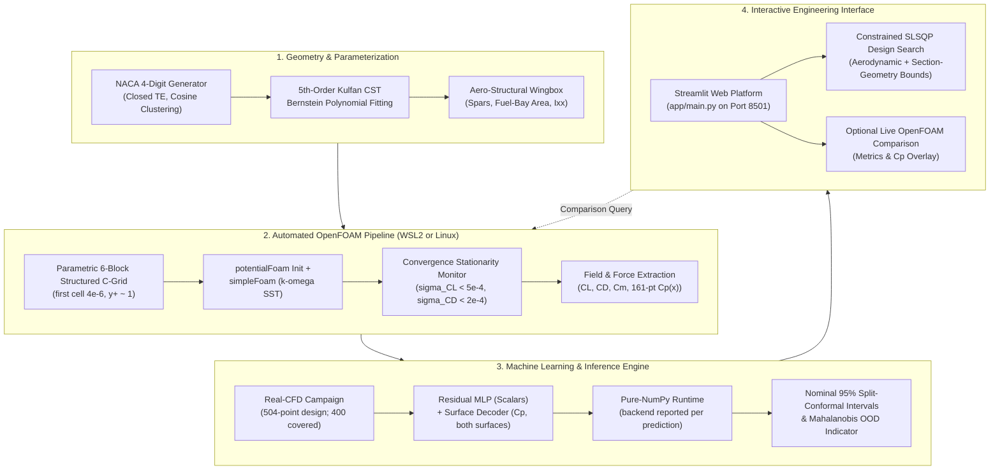

# NeuroFoil: Aerodynamic Research Engineering & CFD Comparison Platform

An engineering research platform integrating a 2D Reynolds-Averaged Navier–Stokes
(RANS) OpenFOAM workflow, scalar and surface-pressure surrogate interfaces,
aero-structural wingbox cross-section calculations, and uncertainty/domain-
applicability indicators. It is a research tool, not an airworthiness or design
certification system.

> **Artifact and evidence status (real-CFD release):** The shipped dataset and
> trained model artifacts in `data/processed/` and `models/` are generated from
> the completed real OpenFOAM campaign — a 504-point grid (21 NACA airfoils ×
> 4 Reynolds numbers × 6 angles of attack, medium mesh, k-ω SST, incompressible)
> with per-case provenance and checkpointed persistence. **Coverage is 400/504**:
> 374 cases converged cleanly; the remaining 104 operating points (thin-airfoil
> stall and negative-α regimes) are physically unsteady under steady RANS —
> limit-cycle oscillation was verified from force histories across three
> independent attempts — and are excluded from training and flagged by the
> domain-applicability indicators at inference. The shipped bundle
> (`model_provenance = openfoam`) is trained on the 375 converged rows (374
> production + 1 adjacent validation point).
>
> **Measured surrogate performance.** On grouped per-airfoil holdouts (airfoils
> never seen in training): R² 0.966 (CL) / 0.933 (CD) / 0.860 (CM); field
> R² 0.892; integrated-lift physics consistency R² 0.983. Split-conformal
> coverage on unseen airfoils: CL 0.951 / CD 0.918 / CM 0.967 / Cp 0.957
> against the 0.95 nominal level. Breakdowns (per-airfoil, per-condition,
> per-station) are computed by `scripts/evaluate_surrogate.py`
> (`reports/evaluation/surrogate_breakdown.json`): CL extrapolation MAE is
> worst at negative incidence (0.159 at −6° vs 0.056 at +2°), CD relative MAE
> on held-out airfoils is 9.7% with near-zero bias, and the Cp error profile
> peaks near the leading edge.
>
> **Uncertainty distinctions, stated precisely.** The CD interval
> under-covers: 0.918, Wilson 95% CI [0.890, 0.906] excluding 0.95 —
> heteroscedastic residuals against a single global quantile. Mondrian
> regime-conditional calibration is shipped (CD coverage 0.967 on the
> evaluation split), and a larger calibration set is the identified v2 fix.
> The Cp band is pointwise: per-station coverage 0.957, but simultaneous
> whole-curve coverage is 0.492 (descriptive inflation factor 2.02×) — joint
> coverage is the v2 target.
>
> **Design search is CFD-validated.** From NACA 2412 (α = +4°) the optimizer
> returns NACA 2313 (α = +7°), and OpenFOAM confirms the gain — L/D
> 66.86 → 70.80 (+3.93 measured vs +4.70 predicted; the surrogate is ~16%
> optimistic on the gain, ranking correct). See
> `reports/evaluation/design_search_validation.json`.

---

## 1. System Architecture



---

## 2. Mathematical & Engineering Foundations

### 2.1 Geometry & Class-Shape Transformation (CST)
Airfoil profiles are parameterized using the NACA 4-digit formulation with a modified trailing-edge closure coefficient ($a_4 = -0.1036$) to eliminate finite trailing-edge thickness singularities during structured mesh generation:

$$y_t(x) = 5t \left( 0.2969\sqrt{x} - 0.1260x - 0.3516x^2 + 0.2843x^3 - 0.1036x^4 \right)$$

Surfaces are fitted to a 5th-order Kulfan Class-Shape Transformation (CST) representation using Bernstein polynomials:

$$y(x) = C(x) \cdot S(x) + x \cdot \Delta z_{TE}, \quad C(x) = x^{0.5} (1 - x)^{1.0}, \quad S(x) = \sum_{i=0}^N A_i \binom{N}{i} x^i (1 - x)^{N - i}$$

This maps each airfoil into an invariant 12-dimensional parameter vector ($\mathbf{A}_{upper}, \mathbf{A}_{lower} \in \mathbb{R}^6$) for dimension reduction and geometric interpolation.

### 2.2 Fluid Dynamics & Turbulence Modeling
* **Governing Equations**: Configured steady incompressible Navier–Stokes equations (`simpleFoam`, OpenFOAM v2606):
  $$\nabla \cdot \mathbf{U} = 0, \qquad \nabla \cdot (\mathbf{U} \otimes \mathbf{U}) = -\frac{1}{\rho}\nabla p + \nabla \cdot \left[ (\nu + \nu_t) (\nabla \mathbf{U} + (\nabla \mathbf{U})^T) \right]$$
* **Turbulence Closure**: Two-equation $k$-$\omega$ Shear Stress Transport (SST) model (Menter).
* **Initial Field**: The configured pipeline runs `potentialFoam` (irrotational start) before RANS — this
  removes the large startup transient observed with uniform initialization.
* **Numerical settings exercised in solver checks**: Under-relaxation factors p = 0.1, U = 0.3, k/ω = 0.5. In the recorded checks, hotter
  factors (p = 0.3 / U = 0.7) produce a sustained force limit cycle on these C-grids.
* **Near-Wall Discretization Target**: First-cell height 4×10⁻⁶ chord (targeting y⁺ ≈ 1 at Re = 6×10⁶),
  geometric wall-normal grading solved from the requested first-cell height.
* **Convergence Criterion**: Force-coefficient stationarity over a sliding window (last 50–100 iterations):
  $$\sigma_{C_L} < 5.0 \times 10^{-4}, \quad \sigma_{C_D} < 2.0 \times 10^{-4}, \quad \sigma_{C_m} < 5.0 \times 10^{-4}$$
  with solver residual targets p < 10⁻⁵, U, k, ω < 10⁻⁶ and a 3000-iteration cap. Every
  dataset row records its true status (`converged` / `unconverged`).

### 2.3 Aero-Structural Wingbox Cross-Section Metrics
To reject surrogate-optimized candidates that violate simple section-geometry
constraints, the platform computes internal cross-sectional metrics:
* **Spar Web Depths**: Front spar at $x/c = 0.20$, rear spar at $x/c = 0.65$:
  $$h_{\text{front}} = y_u(0.20) - y_l(0.20), \quad h_{\text{rear}} = y_u(0.65) - y_l(0.65)$$
* **Fuel-Bay Cross-Sectional Area**: $A_{\text{fuel}} = \int_{0.20}^{0.65} \left(y_u(x) - y_l(x)\right) dx$
* **Second Moment of Area ($I_{xx}$)**: about the centroidal neutral axis $\bar{y}$
  (see `src/geometry/structures.py`). This geometric section property is not a
  material bending stiffness $EI$ and does not replace structural analysis.

### 2.4 Uncertainty Quantification & Domain-Applicability Indicators
* **Nominal 95% Split-Conformal Intervals**: when calibration artifacts are
  available, held-out-airfoil residual quantiles can define intervals for $C_L$,
  $C_D$, and $C_m$, plus per-chord-point $C_p(x)$ bands. “95%” is the nominal
  level, not a claim of achieved coverage: empirical coverage is reported separately
  and may differ, especially on unseen geometries. Without compatible calibration
  artifacts, the runtime uses indicative analytic uncertainty bands.
* **Mahalanobis Distance ($D_M$)**: evaluated against the available feature
  covariance over (m, p, t, α, Re), with explicit fallback provenance when an
  empirical real-campaign manifold is unavailable:
  $$D_M(\mathbf{x}) = \sqrt{(\mathbf{x} - \boldsymbol{\mu})^T \boldsymbol{\Sigma}^{-1} (\mathbf{x} - \boldsymbol{\mu})}$$
* **Engineering-use status**: the UI describes queries as an “in-domain
  surrogate estimate” or “outside calibrated training domain.” This is a
  domain-applicability indicator, not an airworthiness certification. The
  displayed confidence value is a **heuristic confidence score**, not a
  demonstrated probability of correctness or interval coverage.

---

## 3. Solver Checks (measured on this codebase)

The available NACA 0012 solver checks are summarized below. They
exercise limited pipeline behavior; the full surrogate evaluation is reported
separately (grouped per-airfoil holdouts, coverage and per-condition
breakdowns).

NACA 0012, incompressible k-ω SST, medium C-grid (18,048 cells, y⁺ ≈ 1),
potentialFoam-initialized, relaxation p 0.1 / U 0.3 / k,ω 0.5, 3000 iterations:

| Case | CL | CD | Cm (c/4) | Status |
| :--- | :--- | :--- | :--- | :--- |
| α = 0.0°, Re = 6.0×10⁶ | −0.0042 | 0.00879 | +0.0008 | converged (CD/Cm); CL within 9.5×10⁻⁴ |
| α = 4.0°, Re = 6.0×10⁶ | +0.4388 | 0.00951 | +0.0024 | converged (σ_CL = 2.2×10⁻⁴) |

The α = 4° result and the near-zero symmetric case are consistent with the
expected qualitative trends. The implied two-point lift slope is 6.29 rad⁻¹,
close to thin-airfoil theory (2π); the fully turbulent drag level
(CD ≈ 0.0095) is above the cited transitional experimental value (≈0.0081), as
expected without a transition model. These two checks are not a broad solver or
surrogate validation.

Mesh sensitivity (α = 4.0°, Re = 6.0×10⁶):

| Mesh | Cells | CL | CD |
| :--- | :--- | :--- | :--- |
| coarse | 8,640 | 0.43133 | 0.010730 |
| medium (production) | 18,048 | 0.43875 | 0.009509 |
| fine | 36,000 | 0.45908 | 0.008309 |

CD decreases monotonically across these three meshes. The medium-to-fine
spacing is a measured mesh-sensitivity difference for this case; it is not, by
itself, a formal discretization-error or asymptotic-convergence estimate.

---

## 4. Engineering Scope & Known Limitations

1. **2D Flow Assumption** — sectional coefficients only; no induced drag, downwash, or tip effects. Finite-wing analysis requires lifting-line/panel post-processing.
2. **Incompressible Flow Assumption** — `simpleFoam`; valid for M ≤ 0.3; no transonic effects or wave drag.
3. **Linear Eddy-Viscosity Closure** — k-ω SST (Boussinesq); separation behavior
   under severe adverse gradients requires validation, and no laminar–turbulent
   transition model is used (hence fully turbulent drag levels).
4. **Configured input bounds** — Camber 0 ≤ m ≤ 0.06 · camber location
   0 ≤ p ≤ 0.60 · thickness 0.06 ≤ t ≤ 0.18 · α ∈ [−6°, 14°] ·
   Re ∈ [1×10⁶, 6×10⁶]. Being inside these bounds does not by itself establish
   model validity.
5. **Real-CFD artifacts shipped; scope is bounded** — `data/processed/` holds
   the completed campaign dataset (400/504 covered; 374 converged training
   rows) and `models/` holds the bundle trained on those rows
   (`model_provenance = openfoam`). Legacy synthetic placeholders are archived
   under `models/legacy_synthetic/` and `data/processed/legacy_synthetic/`.
   The surrogate is valid inside the covered envelope; the 104 uncovered
   operating points (thin-airfoil stall / negative-α limit cycles) are flagged
   by the domain guard rather than predicted.
6. **Backend-dependent outputs** — callers must inspect `model_backend`,
   `model_provenance`, and `field_backend`. Analytic fallback scalars are not
   neural/CFD-trained predictions; legacy bundles without a Cp target scaler use
   analytic Cp even when scalar inference is neural.

---

## 5. Project Directory Structure

```
NeuroFoil-Core/
├── app/
│   └── main.py                       # Streamlit engineering dashboard
├── configs/
│   └── default_cfd.yaml              # Meshing, solver, relaxation, convergence settings
├── data/
│   ├── processed/                    # real-CFD campaign dataset (400/504 covered) + legacy_synthetic/ archive
│   └── raw_cases/                    # Per-case solver logs & postProcessing (gitignored)
├── models/                           # real-CFD-trained bundle + runtime scalers (legacy archived)
├── notebooks/
│   └── neurofoil_surrogate_training_v2.ipynb  # Kaggle/local GPU training (grouped splits + conformal UQ)
├── paper/                            # work-in-progress LaTeX manuscript
├── scripts/
│   ├── build_kaggle_notebook_v2.py   # Regenerates the training notebook
│   ├── run_cfd_batch.py              # Ad-hoc batch CFD runner
│   ├── run_dataset_campaign.py       # Resume-safe parallel dataset campaign (504 cases)
│   ├── run_single_case.py            # Single-case solver comparison runner
│   └── check_env.py                  # Environment inspector
├── src/
│   ├── cfd/                          # case_builder, convergence, extractor, mesh_generator
│   ├── config.py                     # Config loader + WSL/Linux solver bridge
│   ├── dataset/                      # pipeline (single-case CFD), sampler (LHS)
│   ├── geometry/                     # naca (NACA4+CST), structures (wingbox), validator
│   └── models/                       # inference (NumPy NN runtime), uncertainty (conformal UQ)
├── tests/                            # unit and integration tests
├── RUN_CFD_PACKAGE_README.md         # How to run the campaign on another machine
└── requirements.txt / pyproject.toml
```

---

## 6. Installation & Quick Start

### 6.1 Prerequisites
* **OS**: Windows 10/11 with WSL2 (Ubuntu 24.04 + OpenFOAM v2606), or native Linux.
* **Python**: 3.10, 3.11, or 3.12.
* *The dashboard runs without OpenFOAM or PyTorch* — OpenFOAM is needed only
  for live comparison and dataset generation. Whether displayed scalars or Cp
  fields are neural or analytic is reported separately in the UI/API.

### 6.2 Setup
```bash
git clone https://github.com/BLACKNIGHT-cloud12/NeuroFoil-Core.git
cd NeuroFoil-Core
pip install -e .
```

### 6.3 Launch the Interactive Dashboard
```bash
streamlit run app/main.py
```
Open **http://localhost:8501** for direct geometry controls, backend-labelled
scalar and Cp estimates, nominal uncertainty bands, wingbox cross-section sizing,
surrogate inverse-design search, an optional OpenFOAM comparison, and cached
polar sweeps.

---

## 7. Running Tests

```bash
python -m pytest tests/ -v
```

The suite covers geometry, meshing, case building, structures, UQ, and inference
backend behavior. Solver-environment integration tests may skip when the required
OpenFOAM/WSL environment is unavailable. No fixed test count is asserted here
because the suite evolves.

---

## 8. License & Citation

Distributed under the Apache License 2.0 — see [`LICENSE`](LICENSE).
Citation metadata lives in [`CITATION.cff`](CITATION.cff); the manuscript source
is under [`paper/`](paper/).
